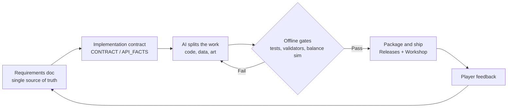

<div align="center">


<br />

# Hi, I'm stanley1028 👋

### In one sentence: I'm an AI application developer who drives AI with specs, tests, and release gates — and ships work real people subscribe to.

<sub>[English](README.md) · [简体中文](README.zh-CN.md)</sub>

[](#)
[](#)
[](https://steamcommunity.com/profiles/76561199800253923/myworkshopfiles/?appid=1062090)
[](https://github.com/stanley-1028?tab=repositories)

</div>

---

## 🙋 Who I am

I'm not a game engine engineer, and I'm not an algorithm researcher — **I'm an AI application developer**.

What I do: put an LLM inside an engineering process that can be verified, then take an idea all the way to "shipped." I own the requirements, the direction, and the acceptance; the code, data, art pipeline, verification, and documentation are built in collaboration with **DeepSeek V4.1 Flash** — and nothing ships until the tests and offline gates are green.

These projects are how I practice that: three Timberborn mods, all live on the Steam Workshop with real subscribers. HDBF and MWP have public player feedback — reported, root-caused, fixed, and re-shipped.

> The method in one line: **write the spec first; pass the gates before you ship.**

---

## 🧰 Tech stack

### AI application layer (my home turf)

| Capability | How I actually use it |
|---|---|
| **LLM pair-development** | DeepSeek V4.1 Flash acts as the engineering team: decompose → implement → verify independently → package. I set the specs and make the calls. |
| **Prompt / context engineering** | Requirements docs, implementation contracts (CONTRACT), and a requirements traceability matrix (REQ → code → test) as the context backbone |
| **AI image generation** | Seedream for Workshop covers and modeling references, then hand-laid typography |
| **Facts over guesses** | Read IL / metadata from the game's own assemblies to establish API facts, then write them into `API_FACTS` for implementation to cite |

### Engineering

```text
C# / .NET 9       Layered architecture (Core / Gameplay / Integration / UI), zero-NuGet test runner
Python            Procedural 3D models (Blender bpy), textures and UVs, blueprint generation and validation tools
JSON, data-driven One source of truth for numbers -> 24 generated blueprints plus their localization keys
PowerShell        Build -> test -> data validation -> packaging -> install, in a single command
Git / GitHub      Releases, SHA-256 checksums, versioning and changelogs
```

### Quality and delivery

- **Offline gates**: **1,455** offline tests (732 + 510 + 213), data validators, balance simulation, and **44** release gates (HDBF)
- **Reproducible delivery**: manifests, checksums, three-language localization (English / Simplified Chinese / Traditional Chinese)
- **Distribution**: GitHub Releases + Steam Workshop (the feedback → root cause → re-ship loop)

---

## ⭐ Best work

### [High-Density Box Farm](https://github.com/stanley-1028/HighDensityBoxFarm) — a 3×3×1 indoor farm that stacks

600 crop slots packed into a single 3×3×1 building. The roof is a flat floor, designed so another farm can sit on top (roof-stacking A/B is still in acceptance testing).

<div align="center">

| Workshop subscribers | Visitors | Favorites | Player feedback | Version |
|---:|---:|---:|---:|---:|
| **831** | 2,355 | 33 | 36 comments | v2.5.11 (13 changelog entries) |

</div>

**Why this one**: it's the only project that completed the whole loop — shipped, used, reported, root-caused, fixed, and re-shipped. On the engineering side there are **732 offline tests**, **44 release gates**, and **0 Harmony patches**, plus full ADRs, requirements traceability, and a verification record that honestly lists everything still pending in-game.

<p>
<a href="https://steamcommunity.com/sharedfiles/filedetails/?id=3828809784"></a>
<a href="https://github.com/stanley-1028/HighDensityBoxFarm"></a>
<a href="https://steamcommunity.com/sharedfiles/filedetails/changelog/3828809784"></a>
</p>

> 🔗 **Best work link: [github.com/stanley-1028/HighDensityBoxFarm](https://github.com/stanley-1028/HighDensityBoxFarm)** (Workshop: <https://steamcommunity.com/sharedfiles/filedetails/?id=3828809784>)
>
> Want engineering depth? → [Verification record](https://github.com/stanley-1028/HighDensityBoxFarm/blob/master/docs/VERIFICATION.md) | [v2 architecture](https://github.com/stanley-1028/HighDensityBoxFarm/blob/master/docs/v2/ARCHITECTURE.md) | [ADRs](https://github.com/stanley-1028/HighDensityBoxFarm/blob/master/docs/v2/ADRS.md)

---

## 🧩 Other work

| Project | In one line | Scale | Links |
|---|---|---|---|
| **Steam Engine Expansion** | 12 worker-free steam engines (3 sizes × 4 tiers), 24 blueprints across both factions; fuel and water in, steady power out, with a maintenance system and soft dependencies on three other mods | 510 tests · MIT | [GitHub](https://github.com/stanley-1028/SteamEngineExpansion) · [Workshop](https://steamcommunity.com/sharedfiles/filedetails/?id=3836039641) |
| **Mechanical Water Pump** | 4 tiers of worker-free mechanical drinking-water pumps, with flywheel, gear, and piston animation that follows power efficiency, plus condition wear and maintenance | 213 tests · 4 custom models (16 .timbermesh files) · MIT | [GitHub](https://github.com/stanley-1028/MechanicalWaterPump) · [Workshop](https://steamcommunity.com/sharedfiles/filedetails/?id=3835434644) |

<sub>What all three share: no Harmony patches, no required dependencies, three-language localization, and public source plus verification records. Licensing: SEE and MWP are MIT; HDBF has no LICENSE file yet.</sub>

---

## 🔁 How I ship a project with AI



1. **Spec first** — turn the requirements into a doc, keep the numbers in one authoritative source, and generate everything else from it.
2. **Freeze the contract** — interfaces, save format, and localization keys are pinned before implementation. Any deviation gets recorded as an ADR.
3. **Offline gates** — tests, data validation, balance simulation, and release gates must all be green before packaging. "It compiles" is not "it's done."
4. **Fix from the field** — player report → reproduce → find the root cause (not a patch over symptoms) → fix → lock it with a contract test → re-ship.

---

## 📊 Numbers so far <sub>(as of Nov 9, 2026)</sub>

| Metric | Value |
|---|---:|
| Public projects | 3 (all live on the Steam Workshop) |
| Workshop subscribers, combined | 908 |
| Workshop visitors, combined | 2,625 |
| Offline tests, combined | 1,455 |

<sub>Subscribers and visitors are the sum of each item's "Current Subscribers" and "Unique Visitors" (the same person subscribing to several mods is counted more than once). Data as of Nov 9, 2026.</sub>

---

## 📫 Get in touch

- 🐛 **Bug reports / feature requests**: leave a comment on that mod's Workshop page, or open an issue in its repo ([HDBF](https://github.com/stanley-1028/HighDensityBoxFarm/issues) / [SEE](https://github.com/stanley-1028/SteamEngineExpansion/issues) / [MWP](https://github.com/stanley-1028/MechanicalWaterPump/issues)) — I read both, and I do ship fixes.
- 💬 **Steam**: <https://steamcommunity.com/profiles/76561199800253923>
- 🌏 **Based in**: Macau

<sub>Motto: Let the AI write the code. Let the tests decide whether it ships.</sub>
